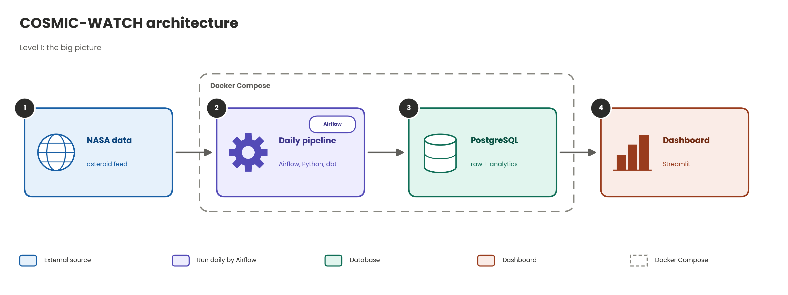
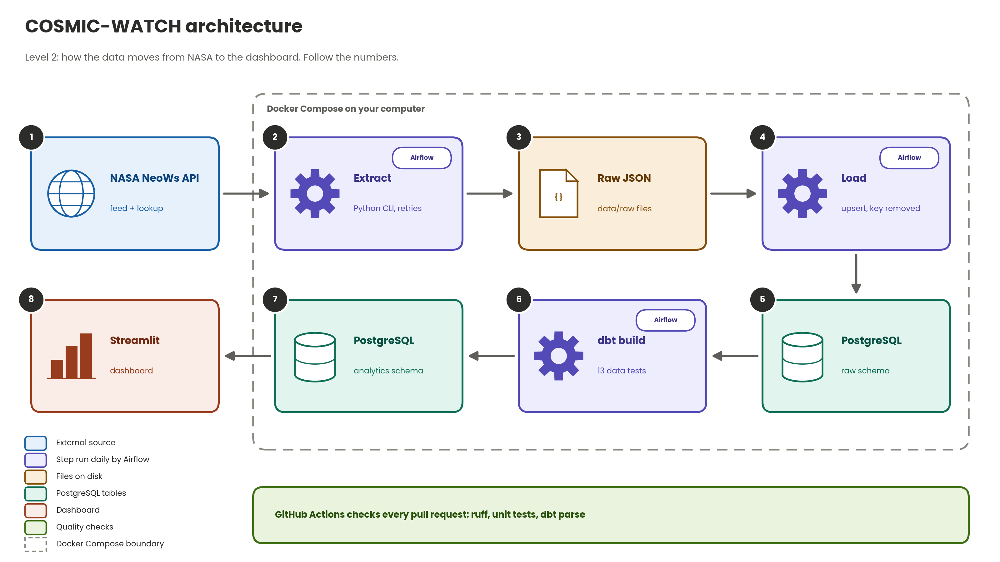
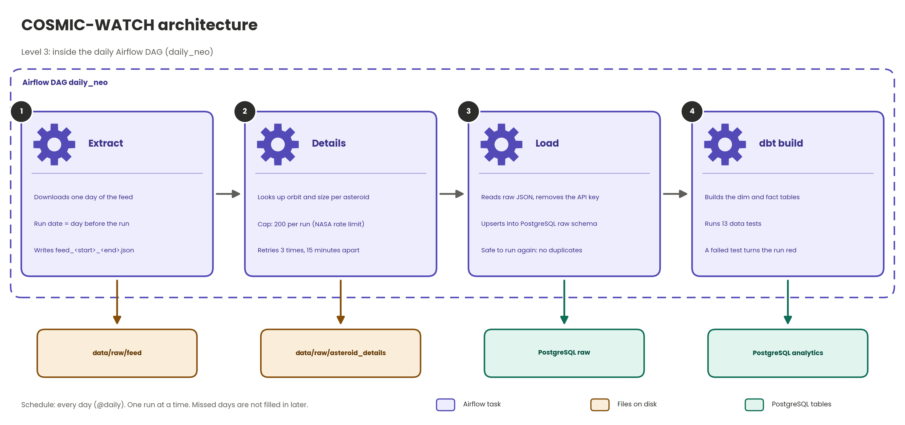

# COSMIC-WATCH

A data pipeline and dashboard for near-Earth asteroids, built from NASA's open **NeoWs** API.
It downloads asteroid data, stores it in PostgreSQL, cleans it with dbt, and shows it in a Streamlit dashboard.
Built by a team of four. Tickets are tracked in Linear, code lives on GitHub.

## Architecture

**The big picture**



**How the data moves from NASA to the dashboard** (follow the numbers)



**Inside the daily Airflow DAG**



<details>
<summary>The same flow as text</summary>

```
NASA NeoWs API
   |  extract + details  (src/pipeline)
   v
data/raw/*.json            raw files, exactly as NASA sent them
   |  load               (src/pipeline/load_raw.py)
   v
PostgreSQL, schema raw     raw JSON stored as-is (JSONB) + an ingestion log
   |  dbt build          (dbt/)
   v
PostgreSQL, schema analytics
   dim_asteroids            one row per asteroid
   fact_close_approaches    one row per close approach
   |
   v
Streamlit dashboard        apps/streamlit/app.py
```

</details>

An Airflow DAG (`dags/daily_neo.py`, named `daily_neo`) runs extract, details, load and dbt every day.

## Folder map

| Folder or file | What is in it |
|---|---|
| `src/pipeline/` | Python code: extract, load, contracts check, command line |
| `dbt/` | dbt project: staging view, the two analytics tables, 13 data tests |
| `dags/` and `compose/` | Airflow DAG and its Docker setup |
| `apps/streamlit/` | The dashboard and a SQL test page |
| `contracts/` | Written rules for what valid NASA data and our tables look like |
| `dashboards/metric_definitions.md` | What every number on the dashboard means |
| `sql/` | Database setup (`001_raw_schema.sql`) and analysis queries (`sql/analysis/`) |
| `docs/` | Guides, including [SQL_QUESTIONS.md](docs/SQL_QUESTIONS.md) and [AIRFLOW_AND_DASHBOARD.md](docs/AIRFLOW_AND_DASHBOARD.md) |
| `tests/` | Automated tests |

## Run it on your computer

You need Docker Desktop, Python 3.10+ and Git. Commands are for PowerShell.

```powershell
git pull
copy .env.example .env          # then open .env in VS Code and set POSTGRES_PASSWORD (and NASA_API_KEY to download new data)
python -m venv .venv
.venv\Scripts\Activate.ps1
pip install -e ".[dbt]"
pip install streamlit

docker compose up -d postgres
python -m pipeline.cli load all data/raw     # raw JSON -> PostgreSQL
cd dbt
dbt build --profiles-dir .                    # builds the analytics tables and runs the tests
cd ..
streamlit run apps/streamlit/app.py           # open http://localhost:8501
```

The repo holds a sample of raw data, so this works without a NASA key. Get a free key at https://api.nasa.gov and keep it only in `.env`.
Full details, including Airflow, are in [docs/AIRFLOW_AND_DASHBOARD.md](docs/AIRFLOW_AND_DASHBOARD.md).

## Checks

```powershell
ruff check .                                   # style and obvious mistakes
python -m pytest                               # automated tests
python -m pipeline.cli contracts raw data/raw  # does the raw NASA data follow contracts/neows_browse.yml?
```

`contracts tables <folder>` checks table files against `contracts/silver_tables.yml`. Both exit with an error when a rule is broken.

## Questions answered with SQL

See [docs/SQL_QUESTIONS.md](docs/SQL_QUESTIONS.md): closest approaches, hazardous asteroids by orbit class, busiest years, and how to run each query.

## Daily Git routine

We never commit straight to `main`. Everything goes through a pull request.

**Start of the day**

```powershell
git switch main
git pull
```

**For each piece of work**

```powershell
git switch -c short-branch-name        # new branch from an up-to-date main
# ... edit files ...
git status                             # check which files changed
git add path\to\file1 path\to\file2    # add specific files, not everything
git commit -m "Short message saying what and why"
git push -u origin short-branch-name   # then open the pull request on GitHub
```

**After your pull request is merged**

```powershell
git switch main
git pull
git branch -d short-branch-name
```

**Rules of thumb**

- Run `git pull` on `main` before you start and before you open a pull request.
- Never commit `.env` or API keys. They stay on your computer.
- Check `git status` before every commit. If many files under `data/raw` show as modified, run `git restore data/raw` unless you meant to change them.
- If a pull request shows red checks, open the failing step, read the message, fix it on the same branch and push again.
- Stuck in a merge editor (VS Code or vim)? Ask the team before guessing.

## What went wrong along the way

A few things broke while we built this. We wrote them down so we remember.

**Our NASA key ended up in the raw files.** NASA sends the request link back with the key inside it, so it got saved with the data. We cleaned the files with `scripts/scrub_api_key.py`, the loader now takes the key out before saving, and we use a new key that only lives in `.env`.

**Pasting the password lines into the terminal did nothing.** They belong in the `.env` file, not the terminal.

**pytest failed on Windows.** It said there was no module called `fcntl`, which only exists on Linux and Mac. We added `src/pipeline/proclock.py`, which works on both.

**Lint failed on a pull request.** The reason was an empty notebook file, which ruff cannot read. We put a valid blank notebook in its place.

**dbt would not run.** Our tests use a newer syntax that needs dbt 1.10 or higher, and one test was indented wrong. We fixed the test and raised the version in `pyproject.toml`.

**We got stuck in a text editor after a git pull.** Git opened it to ask for a merge message. Saving and closing it got us out.

**Lots of files in `data/raw` showed as changed.** Running the pipeline on our own computers rewrites them, so we restore them and keep them out of our commits.

**`app.py` was empty on one teammate's computer.** The file on GitHub was fine, so it was only her local copy.

**A pull request had a merge conflict.** Two of us changed `tests/unit/test_dashboard.py`. We merged `main` into the branch, fixed the file in VS Code, ran the tests and pushed.

**The dashboard looked different on other computers.** Everyone runs it on their own computer with their own database, so it only matches if you have the latest code and the same data loaded.

**CI was switched off for a while.** Its file had been commented out in one commit. We turned it back on.

## Team

Built by a team of four.

- [Nada Abdr](https://github.com/NadaAbdr)
- [Tasneem-MDB](https://github.com/Tasneem-MDB)
- [ShahadDraim](https://github.com/ShahadDraim)
- [MUNAYFAH9](https://github.com/MUNAYFAH9)
